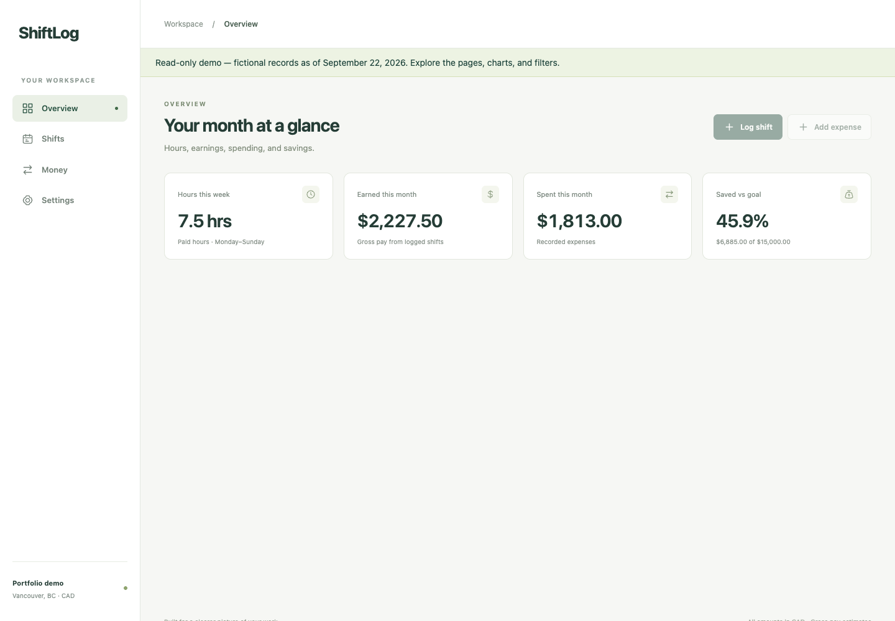

# ShiftLog

A personal work log for two part-time jobs. Log each shift after it ends, see what it earned, record paychecks and expenses, and track savings toward a goal.

Built with Express, PostgreSQL, and vanilla JavaScript as a BCIT CST portfolio project. Tracked history starts **January 1, 2026**.




## Pages

| Page         | What it shows                                                                                             |
| ------------ | --------------------------------------------------------------------------------------------------------- |
| **Overview** | Four numbers: hours this week, gross earned this month, spent this month, saved vs. goal                  |
| **Shifts**   | Every shift with filters, edit, and delete                                                                |
| **Money**    | Savings goal progress, an earned-vs-spent chart, paychecks, and a filterable list of expenses and savings |
| **Settings** | The savings goal and each job's pay rates                                                                 |

## How the numbers are calculated

| Number         | Calculation                                                              |
| -------------- | ------------------------------------------------------------------------ |
| Gross earned   | Each shift's paid time × the pay rate in effect, minus unpaid breaks     |
| Spent          | Sum of recorded expenses                                                 |
| Saved          | Savings deposits minus withdrawals                                       |
| Saved vs. goal | Saved ÷ goal, as a percentage                                            |
| Paychecks      | Amounts you record from your bank deposit; the payslip gross is optional |

A shift belongs to the date it **starts**, so an overnight shift counts in the week and month it began. Weeks start on Monday. All times use the `America/Vancouver` timezone.

### Pay rules

Each job has date-effective pay rates: a base rate, plus an optional premium rate for a time window that can cross midnight. In the example data, Apple pays $20/hour, and Home Depot pays $18/hour with $20/hour between 22:00 and 05:30. A raise is a new rate with a later "effective from" date, so older shifts keep their original pay.

`lib/pay.js` walks through a shift one minute at a time and adds each minute to the rate that applies then. An unpaid break with a known start time is subtracted from the minutes it covers. Without a start time, it is spread proportionally across the shift.

- Apple 9 AM–2 PM, no break: **$100.00**
- Apple 9 AM–6 PM with a 60-minute break: **$160.00**
- Home Depot 8 PM–4 AM with an untimed 30-minute break: **$146.25**
- The same Home Depot shift with its break at 1 AM: **$146.00**

### Rules the app enforces

- Shifts cannot overlap, end before they start, be in the future, or last over 48 hours.
- Savings can never go below zero. Deleting a deposit that a later withdrawal depends on is rejected.
- One paycheck per employer per payday. A recorded $0 is kept as a real zero.
- Deletes ask for confirmation.

Every write runs in a database transaction with a lock, so two requests at the same moment cannot both pass these checks.

## Architecture

```text
Browser: public/index.html + public/js/*.js
                  │ fetch /api/* (JSON)
                  ▼
server.js → routes/api.js → lib/validation.js, lib/pay.js, lib/data.js
                  │ parameterized SQL (pg)
                  ▼
PostgreSQL
```

| File                 | Responsibility                                       |
| -------------------- | ---------------------------------------------------- |
| `server.js`          | Express app, security headers, error responses       |
| `routes/api.js`      | REST routes and transaction locking                  |
| `lib/validation.js`  | Checks every input before it reaches the database    |
| `lib/pay.js`         | Gross pay for one shift                              |
| `lib/data.js`        | Loads records and calculates the dashboard numbers   |
| `lib/time.js`        | Vancouver dates and times                            |
| `public/js/app.js`   | Page routing and button handling                     |
| `public/js/views.js` | HTML for each page                                   |
| `public/js/forms.js` | Pop-up forms for shifts, transactions, and paychecks |

The server does every calculation; the browser only displays the results. There is no frontend framework or ORM.

## Database

| Table           | Purpose                                                                      |
| --------------- | ---------------------------------------------------------------------------- |
| `jobs`          | The two employers                                                            |
| `shifts`        | Start, end, unpaid break, and `source` (`manual`, or `schedule` if imported) |
| `pay_rates`     | Base/premium rates per job, each with an effective-from date                 |
| `transactions`  | Expenses, savings deposits, and savings withdrawals                          |
| `paychecks`     | Employer, payday, amount received, optional gross, notes                     |
| `savings_goals` | The single savings goal                                                      |

Migrations in `sql/` run in order through `npm run migrate`, each inside a transaction. Each one runs only once, and applied versions are recorded in `schema_migrations`. Old migrations are never edited; a change is a new file. `005_simplify.sql` removed the tables and columns for features that were cut, and made a shift's end time required. **Back up the database before running a migration that drops data.**

Shifts from January 1 to September 17, 2026 were imported once from a regular schedule. They show a **Schedule estimate** label so days that differed can be corrected.

## Running it locally

Requirements: Node.js 22+ and a running PostgreSQL server.

```sh
npm ci
cp .env.example .env
createdb shiftlog   # first time only
npm run migrate
npm run build
npm start           # http://127.0.0.1:3000
```

| Variable                 | Purpose                                                               |
| ------------------------ | --------------------------------------------------------------------- |
| `DATABASE_URL`           | Database connection; defaults to the local `shiftlog` database        |
| `PORT` / `HOST`          | Defaults `3000` / `127.0.0.1`                                         |
| `TEST_DATABASE_URL`      | Separate test database; its name must end in `_test`                  |
| `PLAYWRIGHT_CHROME_PATH` | Use an installed Chrome for browser tests instead of Playwright's own |

## Tests

```sh
npm test                    # unit tests: pay, time, validation (no database)
createdb shiftlog_test      # first time only
export TEST_DATABASE_URL=postgresql://localhost/shiftlog_test
npm run test:integration    # every API route against a real database
npx playwright install chromium
npm run test:e2e            # Shifts, Money, and Overview in a real browser
npm run format:check        # Prettier
```

Integration and browser tests create a uniquely named schema in the test database, run all migrations, and delete the schema afterwards. They never touch the real database.

## API

All routes start with `/api` and use JSON. Errors return `{ "error": "message" }`; successful deletes return 204.

| Route                                                      | Purpose                                             |
| ---------------------------------------------------------- | --------------------------------------------------- |
| `GET /jobs`                                                | The employers                                       |
| `GET/POST /shifts`, `PATCH/DELETE /shifts/:id`             | Shifts with calculated paid hours and gross pay     |
| `GET/POST /transactions`, `PATCH/DELETE /transactions/:id` | Expenses, deposits, withdrawals; filterable by date |
| `GET/POST /paychecks`, `PATCH/DELETE /paychecks/:id`       | Paychecks                                           |
| `GET/PUT /pay-rates`                                       | Pay rates by job and effective date                 |
| `GET/PUT /savings-goal`                                    | The savings goal                                    |
| `GET /dashboard`                                           | Overview numbers, monthly chart data, and paychecks |

The shift fields are named `clock_in` and `clock_out` in the API, although the UI calls them start and end.

## Public demo

`npm run build:demo` builds a read-only copy into `dist-demo/` that uses fictional data (as of September 22, 2026) and never reads the database, `.env`, or backups. GitHub Actions publishes it to GitHub Pages on every push to `main`. Preview it locally with `node scripts/serve-demo.js` at http://127.0.0.1:3102/ShiftLog/, and test it with `npm run test:demo`.

## Scope

Deliberately not included yet: tax and deduction estimates, calendar import, overtime, and login. Without login the app is for private use only. Do not host it with real financial data unless access is protected.
