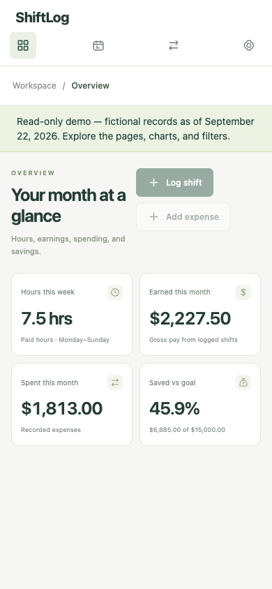

# ShiftLog

A personal work log and financial planning dashboard for multiple jobs. Record completed shifts, calculate gross earnings, track actual paychecks and spending, and follow savings toward a goal.

Built with Express, PostgreSQL, and vanilla JavaScript for a BCIT CST portfolio. Tracked work and financial history starts **January 1, 2026**.

## Public portfolio demo

The repository includes a read-only GitHub Pages build with fictional records,
separate from the PostgreSQL application. It displays a fixed September 22, 2026
snapshot so the sample charts and quick date filters stay consistent over time.
Navigation, filters, and charts work; saving is disabled.
The build uses the application's pay and summary calculations and never reads the
personal database, `.env`, or backups.

To publish:

1. In repository **Settings → Pages → Build and deployment**, select **GitHub Actions**.
2. Push the demo changes to `main`.
3. Wait for **Actions → Deploy portfolio demo** to complete successfully.
4. Use the deployed Pages URL for the portfolio's **Live demo** link. With the
   current repository name and no custom domain, the expected address is
   `https://bayingana55.github.io/ShiftLog/`.

The workflow tests the app, builds only the demo assets, and publishes `dist-demo`.
Subsequent pushes to `main` update the demo automatically. The full editable app
still runs with `npm start` and PostgreSQL.

For a local preview:

```sh
npm run build:demo
node scripts/serve-demo.js
# Open http://127.0.0.1:3102/ShiftLog/
```

Run the demo's desktop/mobile tests with `npm run test:demo` after building.
Install Chromium first with `npx playwright install chromium`, or set
`PLAYWRIGHT_CHROME_PATH` to an existing Chrome executable.

## Features

- Responsive dashboard with weekly hours, gross earnings, recorded expenses, actual pay received, cash remaining, and savings progress.
- **Log shift** with explicit start/end dates and times, unpaid breaks, editing, confirmed deletion, and filters. Overnight shifts use the next calendar date for the end.
- Centralized date-effective base/premium pay rules and precise or proportional unpaid-break allocation.
- Actual paycheck CRUD by employer and payday, with optional gross amount and notes.
- Expenses, savings deposits, and withdrawals.
- January-2026-to-current-month charts of earnings, expenses, and the savings balance.
- A configurable savings goal, initially **$28,000**.
- Automated unit, PostgreSQL integration, and desktop/mobile browser tests.

The application is a completed-work log: you enter each shift after it ends. There is no clock-in/out timer.

## Screenshots




## Financial concepts

| Concept               | Source / calculation                                                |
| --------------------- | ------------------------------------------------------------------- |
| Gross earnings        | Completed logged shifts × applicable pay rates, minus unpaid breaks |
| Actual pay received   | Amounts manually recorded against each employer/payday              |
| Actual expenses       | Recorded expense transactions                                       |
| Actual cash remaining | Recorded pay received − actual expenses; not automatically savings  |
| Actual savings        | Recorded savings deposits minus withdrawals                         |

Actual pay and cash remaining are **Not recorded** when a month contains no paycheck records. An explicitly recorded zero paycheck is $0, not missing data. When only some paychecks are entered, the recorded total may be incomplete; the UI shows the record count and labels that limitation. Missing paychecks never erase gross earnings.

Actual savings progress and remaining goal use deposits minus withdrawals.

## Editing from Overview

Every summary card has visible actions for its underlying records:

- **Actual expenses → Add expense / Edit / remove:** manage recorded purchases without leaving Overview. Search the record list to find older entries.
- **Actual savings balance → Add / Withdraw / History:** record transfers or edit/delete existing records. Withdrawals do not count as purchases.
- **Remaining actual goal → Edit goal:** change the target directly.
- **Pay and hours cards:** add/edit/delete paychecks or shifts through searchable record managers.

Deletes require confirmation. Savings changes that would leave the current balance negative are rejected; correct the associated withdrawal before deleting a deposit it depends on. Record an expense separately if withdrawn savings was spent. Savings transfers are separate from the “actual cash remaining” calculation, which remains actual pay minus actual expenses.

## Paydays and paychecks

A paycheck record stores the employer, payday, the amount actually received, an optional gross amount copied from the payslip, and notes. One record is allowed per employer and payday, so both jobs can have a record on the same date. A recorded zero means $0 was received; a month with no records shows **Not recorded**.

## Tech stack and architecture

HTML, compiled Tailwind CSS/component CSS, vanilla JavaScript ES modules, Chart.js, Node.js 22+, Express 5, PostgreSQL, `pg`, and `dotenv`. Moment Timezone provides consistent Vancouver timezone data on the server and browser. Playwright and Prettier are development tooling. No frontend framework or ORM.

```text
Browser: public/index.html + public/js modules
                  │ fetch /api/* (JSON)
                  ▼
server.js → routes/api.js → validation / pay / planning / summary modules
                  │ parameterized pg queries
                  ▼
PostgreSQL
```

`lib/pay.js` owns gross earnings calculations. `lib/planning.js` owns the history start date and month sequence. `lib/data.js` builds the dashboard and chart data. `public/js/planning-views.js` renders cash-flow, and paycheck tables. The frontend displays server-calculated figures.

## Database design

| Table               | Purpose                                                                             |
| ------------------- | ----------------------------------------------------------------------------------- |
| `jobs`              | Employer identities and preserved original wage field                               |
| `shifts`            | Start/end instants, break duration/start, `source` (manual or schedule); FK to jobs |
| `pay_rates`         | Date-effective base/premium rules; authoritative for earnings                       |
| `transactions`      | Actual expenses, savings deposits, or withdrawals, with a local calendar date       |
| `savings_goals`     | Singleton savings target                                                            |
| `budget_rates`      | No longer used by the app; to be dropped                                            |
| `payroll_schedule`  | No longer used by the app; to be dropped                                            |
| `payroll_coverage`  | No longer used by the app; to be dropped                                            |
| `paychecks`         | Actual amount, optional gross, notes, creation/update timestamps; FK to jobs        |
| `schema_migrations` | Applied migration versions                                                          |

Migrations are transactional and safe to rerun. `001` preserves existing jobs/shifts and interprets original timestamp-without-zone values as Vancouver wall times when converting to `TIMESTAMPTZ`. Review that assumption before migrating a different legacy database. `002` sets the confirmed Home Depot premium cutoff to 05:30. `003` adds budgets, payday/coverage settings, and actual paychecks. `004` adds withdrawal support and permits custom budget category names. It does not insert actual purchases or payments.

The original `jobs.hourly_wage` remains for compatibility; Settings changes `pay_rates`. Database constraints enforce valid durations, breaks, amounts, and one actual paycheck per employer/payday. Shift writes use a transaction lock and overlap checks, with an additional database index protecting legacy active shifts.

## Local installation

Requirements: Node.js 22+, npm, and a running PostgreSQL server.

```sh
npm ci
cp .env.example .env
createdb shiftlog  # only if the database does not already exist
npm run migrate
npm run build
npm start
```

Open **http://127.0.0.1:3000**. Existing installations only need pending migrations and the rebuilt frontend; do not recreate the database.

### Environment variables

| Variable                 | Purpose                                                                                     |
| ------------------------ | ------------------------------------------------------------------------------------------- |
| `DATABASE_URL`           | Optional deployment connection; otherwise local database `shiftlog` and pg/OS-user defaults |
| `PORT`                   | Default `3000`                                                                              |
| `HOST`                   | Default `127.0.0.1`; use `0.0.0.0` in a hosted container                                    |
| `PGSSLMODE`              | Provider-specific TLS configuration, if required                                            |
| `TEST_DATABASE_URL`      | Dedicated test database; name must end in `_test`                                           |
| `PLAYWRIGHT_CHROME_PATH` | Optional existing Chrome executable for browser tests                                       |

Standard pg variables such as `PGHOST`, `PGUSER`, and `PGPASSWORD` also work. `.env`, keys, local credentials, backups, and dependencies are ignored. `.env.example` contains placeholders only.

### Commands

| Command                                   | Purpose                                              |
| ----------------------------------------- | ---------------------------------------------------- |
| `npm start` / `npm run dev`               | Start Express / restart backend on changes           |
| `npm run build` / `npm run css:watch`     | Compile styles / watch frontend styles               |
| `npm run migrate`                         | Apply pending migrations                             |
| `npm test`                                | Unit tests, no database needed                       |
| `npm run test:integration`                | Real PostgreSQL API tests in disposable test schemas |
| `npm run test:e2e`                        | Browser workflows on desktop/mobile                  |
| `npm run format` / `npm run format:check` | Format source / check formatting                     |

## API overview

All routes below use `/api`. Writes accept JSON. Successful deletes return 204; errors return `{ "error": "Useful message" }`. SQL values are parameterized and validation runs on the server.

| Routes                                                     | Purpose                                                                  |
| ---------------------------------------------------------- | ------------------------------------------------------------------------ |
| `GET /jobs`                                                | Employer list                                                            |
| `GET /shifts?job_id=&from=&to=`                            | Joined work entries with paid hours, gross, and break method             |
| `POST /shifts`, `PATCH /shifts/:id`, `DELETE /shifts/:id`  | Manual work-log CRUD; creation requires an end timestamp                 |
| `GET/POST /transactions`, `PATCH/DELETE /transactions/:id` | Expense/deposit/withdrawal CRUD; reads accept type/category/date filters |
| `GET/POST /paychecks`, `PATCH/DELETE /paychecks/:id`       | Actual-paycheck CRUD; gross amount is optional                           |
| `GET/PUT /savings-goal`                                    | Read/set `{ amount }`                                                    |
| `GET/PUT /pay-rates`                                       | Read/upsert rules by employer/effective date                             |
| `GET /dashboard`                                           | Financial summaries and January-start monthly chart data                 |

An actual paycheck can be recorded with just the amount received:

```json
{
  "job_id": 1,
  "payday": "2026-09-18",
  "actual_amount": 1200,
  "notes": "Example amount; replace with the actual deposit"
}
```

No example amount is seeded into the database. A manual overnight shift uses `clock_in: "2026-09-17T21:00"`, `clock_out: "2026-09-18T05:30"`, and `break_minutes: 30`. These API field names are retained even though the UI calls them start/end dates.

Savings balance reads and transaction writes share a lock, so two withdrawals at the same moment cannot overdraw savings.

## Gross earnings and timezone rules

Apple starts at $25/hour; Home Depot at $20.47 base and $22.72 premium. The confirmed premium window is **22:00–05:30**, configurable in Settings. Base pay resumes at 05:30.

The pay engine splits actual elapsed time at minute boundaries, selects the applicable Vancouver local date/effective rate, and deducts unpaid time. An exact break start deducts from the actual rate segments it overlaps. Without a break start, unpaid minutes are allocated proportionally across rates. Gross is rounded to cents per shift before summing reports.

- Apple 8 AM–1 PM without a break: **$125.00**.
- Apple 10 AM–7 PM with a 60-minute break: **$200.00**.
- Home Depot 9 PM–5:30 AM with an untimed 30-minute break: **$179.64**.
- The same Home Depot shift with its 30-minute break at 1 AM: **$179.51**.

Entire shifts belong to their Vancouver **start date** for weekly and monthly reports. Actual payments belong to their **payday**, which may be a different month. Weeks begin Monday. Dates/times use `America/Vancouver`, not fixed-offset subtraction. `TIMESTAMPTZ` values serialize as UTC and render in Vancouver. Invalid spring-transition wall times are rejected. Calendar dates stay strings.

## Imported shifts

Shifts from January 1 to September 17, 2026 were imported once from a regular schedule (the importer has since been removed). They keep `source = 'schedule'` and show a **Schedule estimate** label, so days that differed from the schedule can be corrected or deleted on the Shifts page.

## Testing

```sh
npm test
createdb shiftlog_test  # once
TEST_DATABASE_URL=postgresql://localhost/shiftlog_test npm run test:integration
npx playwright install chromium
TEST_DATABASE_URL=postgresql://localhost/shiftlog_test npm run test:e2e
```

Tests create uniquely named schemas in the separate test database and clean up only those schemas. Coverage includes pay boundaries, overnight work, January-start reporting, optional paycheck dates, real zero versus missing pay, CRUD, and browser forms. See [verification notes](docs/VERIFICATION.md).

## Deployment and scope

Install dependencies, build CSS, configure a secret database URL and host/port, run migrations as a release step, and start Node behind HTTPS. Use the PostgreSQL provider's verified TLS settings. Serve the frontend/API from the same origin.

The co-op version intentionally excludes tax/CPP/EI calculations, overtime, employer contributions, and authentication. Actual received amounts are recorded from deposits without calculating deductions. Keep real financial data private; a public interactive demo needs disposable data or access controls.

Other limitations: no multiple savings goals, no CSV import/export, no job-creation UI, and no immutable payroll snapshots. Summaries calculate personal records in Node; larger datasets need pagination and cached aggregates. Browser timezone data covers 1970–2030 and should be kept current. Actual cash remaining excludes transfers into savings; those are shown separately as deposits.

## Learning and future improvements

The code demonstrates validation, parameterized SQL, joins, database constraints, transaction locks, timezones, modular business rules, chart datasets, and isolated integration testing. Future improvements include verified payroll rules, immutable pay snapshots, authentication/ownership, exports, and reporting performance.

[PROJECT_WALKTHROUGH.md](docs/PROJECT_WALKTHROUGH.md) explains the implementation. [INTERVIEW_NOTES.md](docs/INTERVIEW_NOTES.md) summarizes the architecture and tradeoffs.
